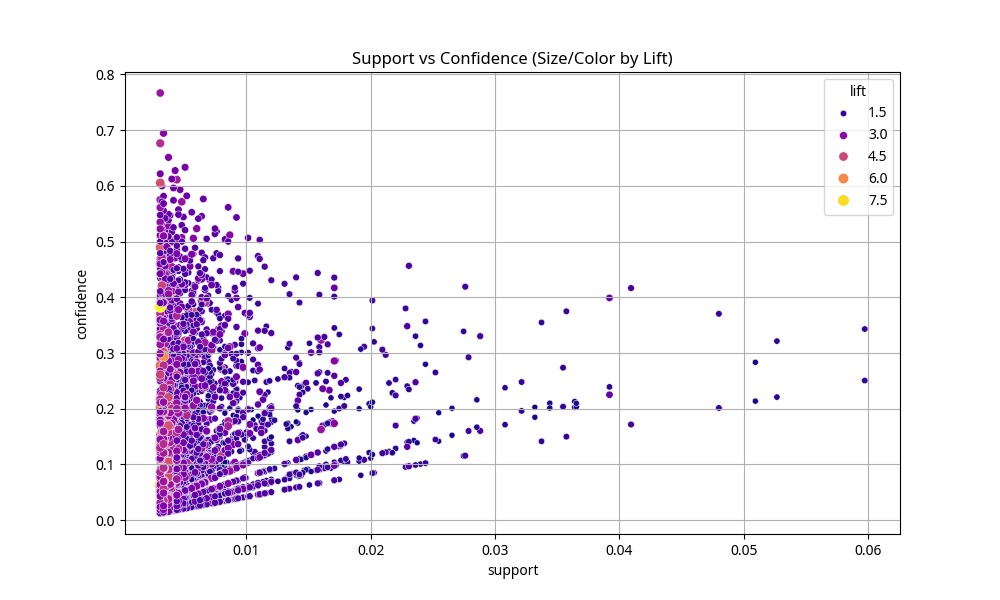

# Market basket analysis
Which grocery items appear together more often than chance would predict? This Python notebook uses Apriori to find frequent itemsets, then ranks association rules by lift.

## Findings from the original analysis
Across 7,501 grocery baskets, 1,443 itemsets met the 0.3% support threshold. They yielded 4,880 directional rules with lift of at least 1.

Of the 60 baskets containing frozen vegetables and soup, 23 also contained milk and mineral water. That is 38.3% confidence and 7.99 lift. The combination appeared in just 0.31% of all baskets, so it would be a candidate for a small merchandising test.

[Inspect the 25 highest-lift rules](top-rules.csv).

## Run the notebook
1. Install the packages with `python -m pip install -r requirements.txt`.
2. Open `market-basket.ipynb` with `jupyter lab` and run the cells in order.
3. The included 12-basket fictional example demonstrates the workflow. To analyze a different dataset, set `input_file` to a headerless CSV containing one basket per row and one item per field.

The notebook exports frequent itemsets, rules and two charts to the working directory. The figures in Findings refer to the original grocery dataset. The demo produces its own results.
